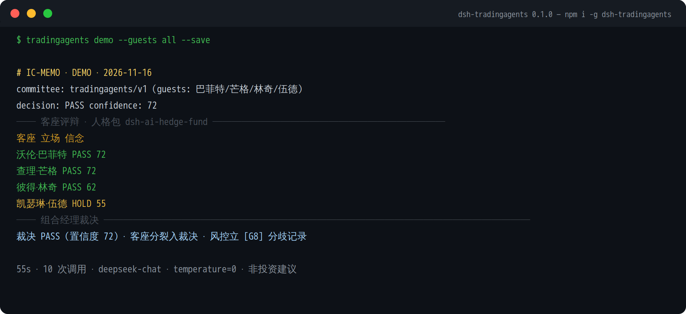

# dsh-tradingagents — TradingAgents, natively on DeepSeek Harness

**A multi-agent investment committee that debates in your terminal — every claim tagged, every verdict auditable.**
**让 TradingAgents 式的多智能体投研议院在你的 DSH 终端里开庭——每个主张带证据标签，每次裁决可审计。**

[](https://github.com/deepseek-ai) [](LICENSE) [](templates/IC-MEMO.md) [](../../actions/workflows/ci.yml)

> Inspired by [Tauric Research's TradingAgents](https://github.com/TauricResearch/TradingAgents) and
> [virattt/ai-hedge-fund](https://github.com/virattt/ai-hedge-fund) — restructured as a
> native DeepSeek Harness experience. Not affiliated; independent community project.



*A real `tradingagents demo --guests all --save` run (npm 0.1.0, 10 calls · 55s): the four
guest seats split — Buffett/Munger PASS@72, Lynch PASS@62, Wood HOLD@55 — the risk officer
logs the split as guardrail [G8], and the PM rules PASS@72 naming it. Replay the full cast:
`asciinema play assets/demo.cast`*

## Why this exists

| | TradingAgents | ai-hedge-fund | **dsh-tradingagents** |
|---|---|---|---|
| Runs where | Python lab | Python lab | **Your DSH terminal/session** — model key you already have |
| Model calls/session | dozens (tool loops × debates) | 10+ | **6 (+1 per guest seat, ≈31–40s)** |
| Market data | Yahoo-centric, keys optional | — | **zero-key by default: CBOE quote/K-line/options-IV + SEC 10-K + nasdaq news (OpenBB), Tencent fallback** |
| Output | text logs | trades table | **[IC-MEMO](templates/IC-MEMO.md)** — open, auditable memo format |
| Evidence discipline | — | — | **every claim tagged `[A#][B#][R#][G#]`, verdict must name what moved it** |
| Abstention | — | — | **PASS is a first-class verdict** — “证据不足，拒绝表态” |
| Risk officer | team output | — | guardrails **only** — constrains, never decides |

The differentiator is **auditability**: analyst → bull → bear (cross-exam) → bull rebuttal →
risk guardrails → portfolio manager. The PM cannot cite anything untagged, cannot overrule
risk triggers, and must abstain when evidence is insufficient.

## Quick start (zero extra keys)

Install as a plugin (npm 0.1.0, ships the engine + skill):

```bash
npm i -g dsh-tradingagents
tradingagents demo --guests all --save          # offline synthetic smoke, ~40s
tradingagents card --ticker NVDA --committee    # zero-key real data → full committee
# register the DSH skill:
ln -s "$(npm root -g)/dsh-tradingagents/skills/dsh-tradingagents" ~/.dsh/skills/dsh-tradingagents
```

Or run from source:

```bash
git clone https://github.com/vicfei/dsh-TradingAgents && cd dsh-tradingagents
python3 scripts/tradingagents.py --ticker DEMO                  # offline synthetic smoke, ~30s
python3 scripts/tradingagents.py --ticker DEMO --guests all --save   # + 4 guest seats, ~40s
python3 scripts/fetch_card.py --ticker NVDA --committee         # real US data → full committee
python3 scripts/fetch_card.py --ticker 600519 --committee       # real A-share data → full committee
```

Real data runs on a multi-provider ladder, CN-cloud friendly and **Yahoo-free**:
**OpenBB rich card (default, `pip install --user openbb`): CBOE quote / K-line /
options-implied vol + SEC 10-K statements + nasdaq news — all zero-key
→ Tencent gtimg fallback (works behind the GFW: quote / PE / mcap / PB +
K-line technicals, same engine for US & A-share) → `--via-relay` full yfinance
through any SSH relay**. Every card item carries its source and as-of date —
the evidence-tag discipline starts at the data layer.

DEMO verdict from the very first smoke run (2026-11-16, temperature=0):

> **PASS @ 55** — “弃权而非看多或看空… 空方的时点错配论证（[R1][R2][R4]：营收/毛利率/份额
> 均早于降价信号 [A7]）说服我偏向谨慎；[A8] 订单金额未披露与 [A9] 估值口径不可复核
> 是两处硬缺口；证据不足以裁决，按纪律 PASS，待 [G8] 任一重审事件落地后再议。”

A committee that **abstains with reasons** is the feature.

## The committee

```
analyst ──► bull ──► bear (cross-exam) ──► bull rebuttal
                                               │
                 ┌─ optional guest seats ──────┤   Buffett / Munger / Lynch / Wood
                 │  (persona pack cross-linked │   from sister repo dsh-ai-hedge-fund;
                 │   each critiques the debate │   they judge the bull-bear clash
                 └────────── through their own methodology)
                                               ▼
                        risk (guardrails only) ──► portfolio manager ──► IC-MEMO
                                                   (BUY/HOLD/SELL/PASS + confidence
                                                    + invalidation triggers)
```

## IC-MEMO — an open format

Every session emits an [IC-MEMO](templates/IC-MEMO.md): decision yaml head, tagged
fact layer, full debate, guardrails, and a verdict that must name its influences.
Unresolved dissent is recorded, never deleted. Spec evolution lives in `docs/`.

## Status & roadmap

v0 engine smoke-tested (see `memos/`). See [ROADMAP](ROADMAP.md) for the
launch package (npm plugin + marketplace + real-data adapters: yfinance / akshare)
and the IC-MEMO standard track.

## Credits & disclaimer

Structure inspired by TradingAgents (Tauric Research) and ai-hedge-fund (virattt) —
this project is an independent native re-implementation for DeepSeek Harness, MIT.
**Not investment advice.** Demo data is synthetic; real-data modes cite their sources.
